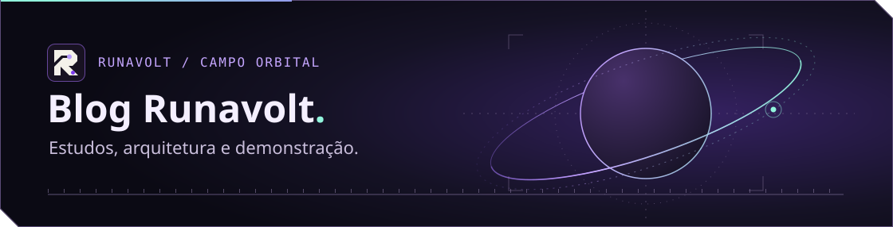

# Blog Runavolt



**[Ver a Central em ação](https://leodah20.github.io/runavolt-blog-publico/demonstracao/) · [Explorar a arquitetura](https://leodah20.github.io/runavolt-blog-publico/) · [Ler o blog de estudos](https://leodah20.github.io/runavolt-blog-publico/estudos/)**

A Runavolt desenvolve uma Central para acompanhar atendimentos técnicos, organizar evidências e preparar o relatório mensal. Este repositório contém o site público que apresenta o produto e a trilha de estudos.

## O que você pode explorar

- **Demonstração:** capturas da interface e dois vídeos de navegação, com chamados e evidências fictícios. A prévia para iPhone mostra o layout web, não um app nativo.
- **Arquitetura:** mapa interativo dos fluxos e de como as partes da Central se relacionam.
- **Estudos:** 13 capítulos com diagramas, exemplos e exercícios sobre desenvolvimento e operação de software.

## O que fica privado

O site é estático e não se conecta à Central em uso. O código da aplicação, o painel administrativo, os logins, os chamados e os anexos reais não fazem parte desta publicação. O código neste GitHub é do **site**, não do aplicativo.

## Trabalhar no site

Com Node.js 22 ou superior, rode na raiz:

```sh
node --test tests/site.test.mjs
node scripts/build-site.mjs
```

O site é gerado em `site/`. A publicação passa pelos testes de conteúdo antes de ir ao GitHub Pages. Para consultar o repositório irmão, veja [Runavolt Docs](https://github.com/leodah20/runavolt-docs).

As fontes e bibliotecas incluídas mantêm os avisos e as licenças dos seus fornecedores.
