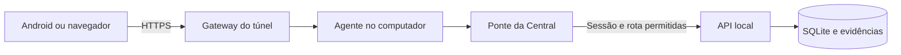

# 9. Acesso remoto e Android

[Índice](README.md) · Pré-requisito: [HTTP, APIs e redes](04-http-apis-e-redes.md).

## Do 5G à mesma Central

Imagine a portaria de um prédio. O endereço te leva ao lugar certo, a porta protege o caminho e a credencial decide onde você pode entrar. No piloto, o APK abre o endereço HTTPS da Central. Não carrega um segundo banco nem faz o papel de servidor.

O **túnel** entrega o tráfego ao computador sem tornar a porta do coletor o endereço público. A **ponte** aceita um conjunto explícito de rotas e aplica login e verificações antes de repassar. O **coletor** arquiva fontes e mantém a aplicação. Desligar o computador remove a origem, ainda que o endereço continue resolvendo. O ngrok não hospeda SQLite ou Ollama. Leia a [documentação de endpoints HTTPS do ngrok](https://ngrok.com/docs/gateway/endpoints/http).

## Dois acessos, duas fronteiras

| Acesso | Primeiro controle | O que continua necessário |
| --- | --- | --- |
| Particular, por Tailscale Serve | Dispositivo e conta dentro da tailnet | Permissão do painel; servidor disponível |
| Piloto sem VPN, por túnel HTTPS | Endereço público e certificado válido | Login individual, sessão, permissão e servidor disponível |
| GitHub Pages | Nenhum login da Central | É documentação estática; não há conexão com a API real |

Uma VPN inclui o dispositivo numa rede privada. Um túnel para a Central entrega apenas o serviço explicitamente encaminhado. Um acesso local continua sendo útil para diagnóstico, mesmo se a borda ou a rede do celular estiverem fora.

## O que muda quando o APK atualiza

Uma correção no HTML/CSS servido pela Central pode aparecer no app e no navegador sem reinstalar. Mudar a tela de abertura, o endereço compilado, o comportamento do WebView ou os recursos incluídos no pacote pode exigir novo APK. Para testar uma atualização, confira um fluxo autenticado nas duas interfaces e confira separadamente o comportamento de uma instalação nova e de uma atualização sobre a anterior. O [painel privado documentado no código](../docs/PAINEL-PRIVADO.md) explica a alternativa de rede privada.

## Exercício: funciona no PC, falha no 5G

A Central abre no computador. No 5G, a página de login carrega, mas Chamados devolve 401. Qual parte você já sabe que respondeu?

**Resposta:** houve resolução de nome, conexão HTTPS e uma resposta que chegou à tela. O 401 em Chamados não prova queda do coletor e aponta para autenticação ausente ou inválida. Verifique a sessão e a requisição específica antes de reiniciar os processos. Se o transporte nem abre, o problema é outro.
