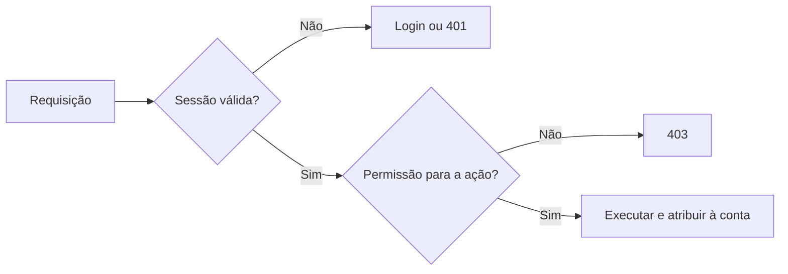

# 10. Identidade e permissões

[Índice](README.md) · Pré-requisitos: [HTTP](04-http-apis-e-redes.md) e [acesso remoto](09-acesso-remoto-e-android.md).

## Login, sessão e autorização

**Autenticação** responde “qual conta é esta?”. **Sessão** permite reconhecer a conta nas próximas requisições. **Autorização** responde “essa conta pode fazer isto, neste chamado?”. **Atribuição** registra quem fez a ação quando ela foi aceita. Cookie, IP e cargo são dados distintos: nenhum, isolado, responde às quatro perguntas.

## Um exemplo de menor privilégio

Suponha que um colaborador possa ler chamados de CFTV e acrescentar uma nota, mas não administrar contas. Ele deve conseguir gravar a nota no chamado autorizado e receber uma recusa em operações administrativas. O servidor deve verificar também o chamado que está sendo modificado, não apenas o menu aberto. Esconder um botão melhora a interface, mas não é controle de acesso.

O console de Operações tem fronteira própria: login administrativo na Central remota **não** o torna acessível pelo APK ou pelo túnel. Isso reduz o alcance de uma sessão remota e mantém inventário, tráfego e dados de diagnóstico fora da Central. Veja a [documentação pública do painel privado](../docs/PAINEL-PRIVADO.md) para comparar com o caminho da rede privada.

## Quem fez o quê sem registrar segredos

O perfil vem da sessão autenticada; o endereço observado ajuda no diagnóstico da conexão, não confirma autoria. Duas contas podem compartilhar um IP de saída e a mesma conta pode alternar entre Wi-Fi e 5G. A trilha registra apenas o necessário para explicar a ação. Nunca registre senhas, cookies, tokens ou conteúdo de chamados num log HTTP de aprendizado.

Quando permitido, descarte sessões inválidas e verifique permissões em cada ação. Cookies de sessão e validações de origem não se substituem; uma sessão legítima ainda precisa de autorização. Para aprofundar: [OWASP Top 10](https://owasp.org/projects/top-ten), em especial controle de acesso e autenticação.

## Exercício: monte a matriz de teste

Numa base fictícia, compare três tentativas: entrar sem sessão, salvar uma nota com conta de leitura, salvar uma nota com conta autorizada. Faça a comparação em Web e Android.

**Resposta esperada:** sem sessão, login ou 401; com sessão sem permissão, recusa sem mutação; com permissão, gravação com autoria. Teste também que a área administrativa não é encaminhada mesmo na última situação.
