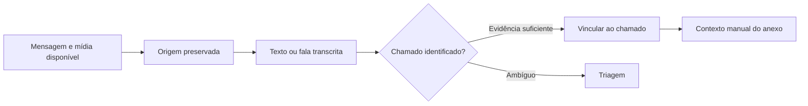

# 11. Evidências multimídia

[Índice](README.md) · Pré-requisitos: [persistência](03-fluxo-de-dados.md), [interface](05-interface-e-experiencia.md) e [IA local](06-ia-mcp-e-custos.md).

## Quatro registros podem descrever a mesma visita

Uma foto sem legenda mostra um conector; um vídeo narra o teste; outra mensagem confirma o resultado; um PDF de e-mail traz o orçamento. Todos podem pertencer ao mesmo caso, mas cada um comprova algo diferente. Mandar tudo rapidamente é válido: mais tarde, a aba **Evidências** permite explicar o que uma imagem específica mostra. Essa nota não substitui a informação original.

## Vínculo forte, candidato e duplicata

Comece por código do chamado, resposta citada ou thread já acompanhada. Sem isso, um par de sinais como **equipamento + local** pode distinguir duas câmeras parecidas. Se uma atualização menciona dois equipamentos existentes e confirma o mesmo teste para ambos, ela não é automaticamente um terceiro chamado. Se só diz “voltou”, e há dois candidatos, não use a hora como prova. A triagem existe para essa dúvida.

Evite repetir a mesma resposta no histórico ou a mesma evidência para um mesmo chamado. Mas duas fotos distintas com a mesma legenda são duas fontes visuais. Identidade da mensagem e identidade do conteúdo têm funções diferentes. Veja [o tratamento de mídias do histórico](../src/cases/history-media.mjs) e [a integração por e-mail](../src/cases/support-mail.mjs). A versão pública desses arquivos pode ser anterior ao piloto descrito aqui.

## Transcrição não é leitura do vídeo inteiro

A transcrição local, quando disponível, extrai **fala** dentro dos limites de processamento. Não permite afirmar a leitura do visor se ninguém leu os caracteres em voz alta. Pode perder uma negação, confundir o nome de um equipamento ou encontrar uma fala sem relação técnica. Use o original ou uma nota verificada para completar o contexto. Não reinstale o app só porque uma mídia ainda está em fila; confirme o estado da captura e da análise.

## E-mail: pendência não é conclusão

As respostas de uma conversa autorizada complementam o histórico, e anexos aceitos podem virar evidência. “Enviarei o orçamento revisado” pode mudar a pendência para aguardar proposta, mas não prova compra, instalação ou restabelecimento. Distinguir esses estados evita relatórios falsamente concluídos.

## Exercício: três mensagens, dois destinos

Entraram duas fotos diferentes com a mesma legenda e um vídeo que explica o teste das câmeras A e B. Como guardar?

**Resposta esperada:** preserve as fotos diferentes, vincule cada uma ao destino sustentado pela fonte, avalie a transcrição como texto auxiliar e atualize os dois chamados se a mensagem sustentar o resultado de ambos. Se uma imagem não puder ser atribuída, deixe-a na triagem e peça contexto no painel, não no grupo por padrão.
